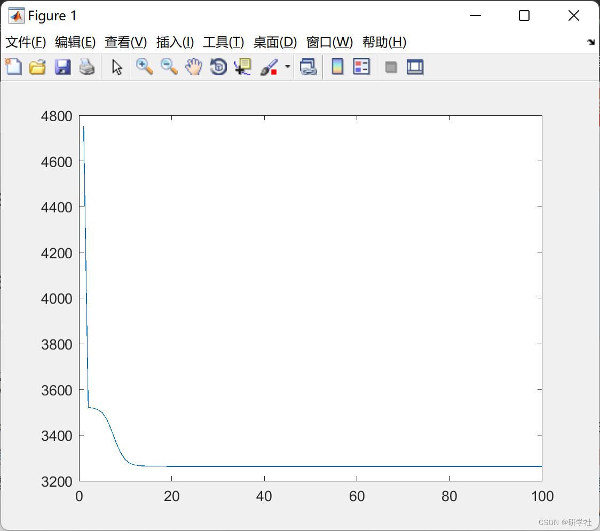
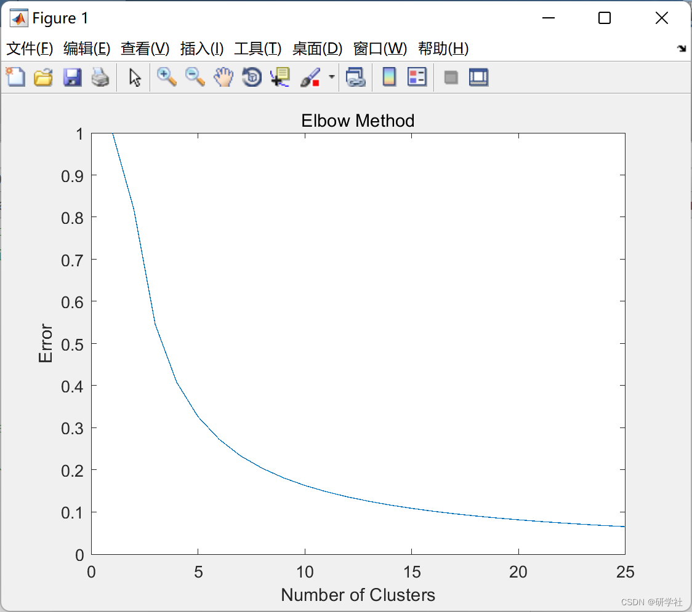
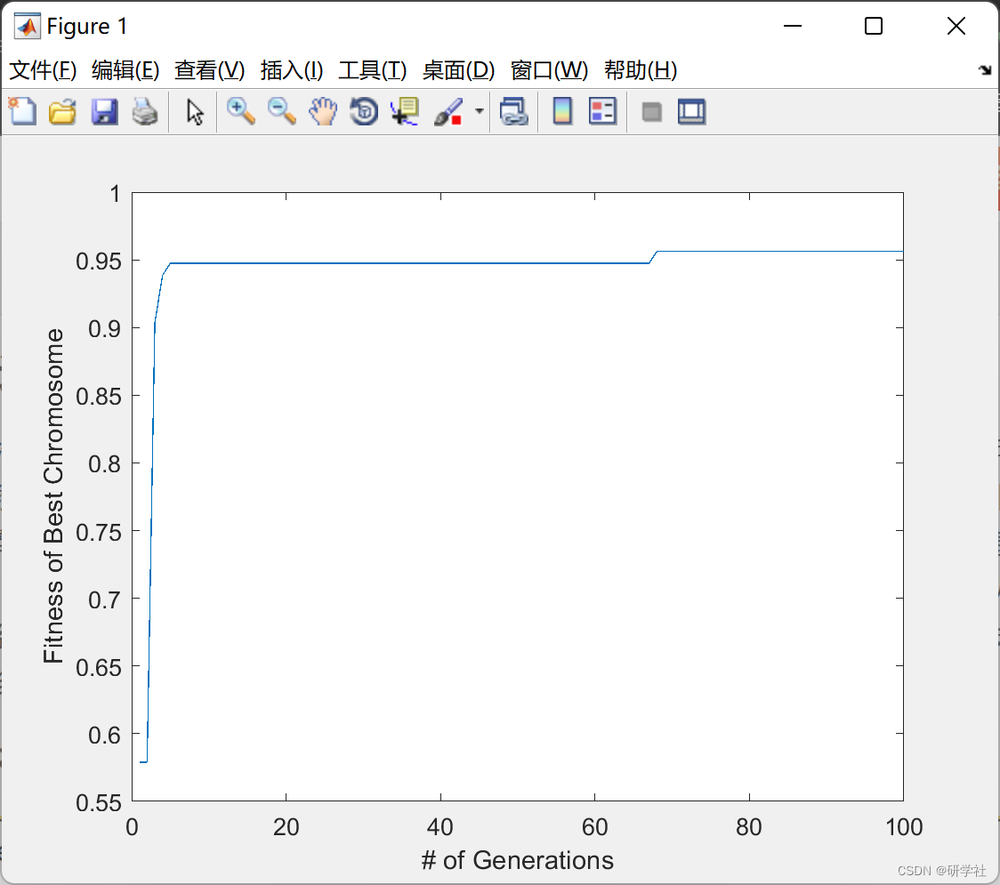
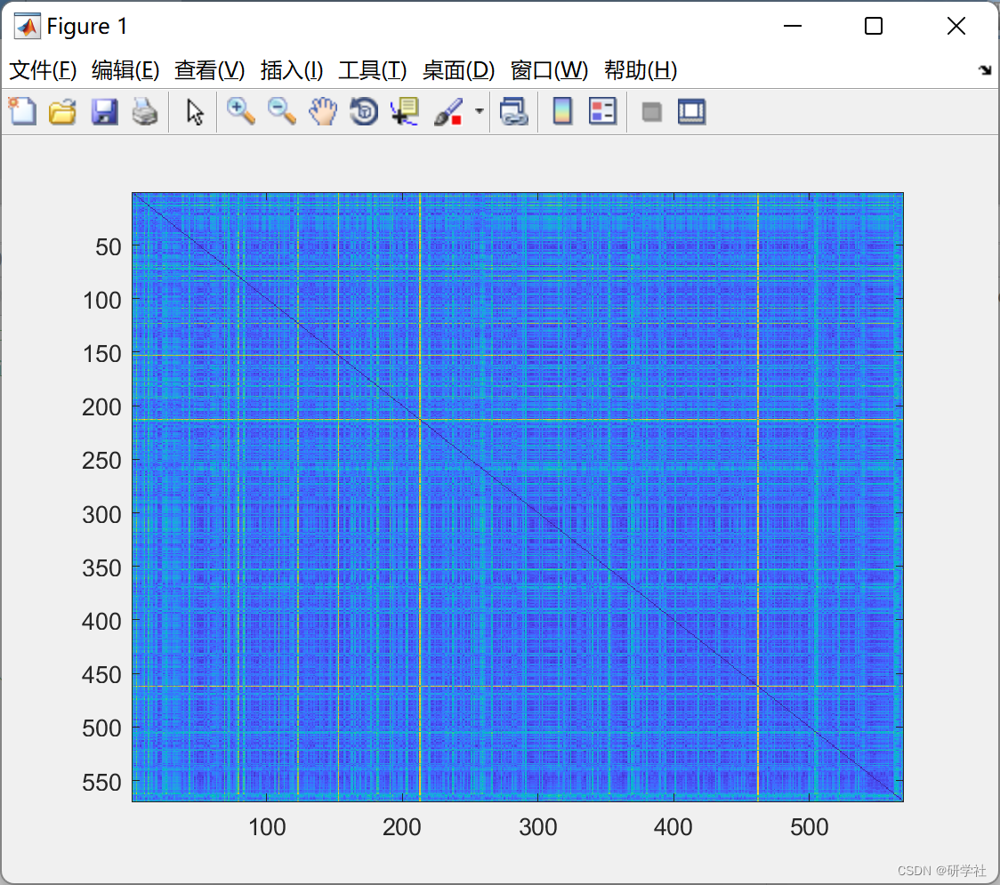
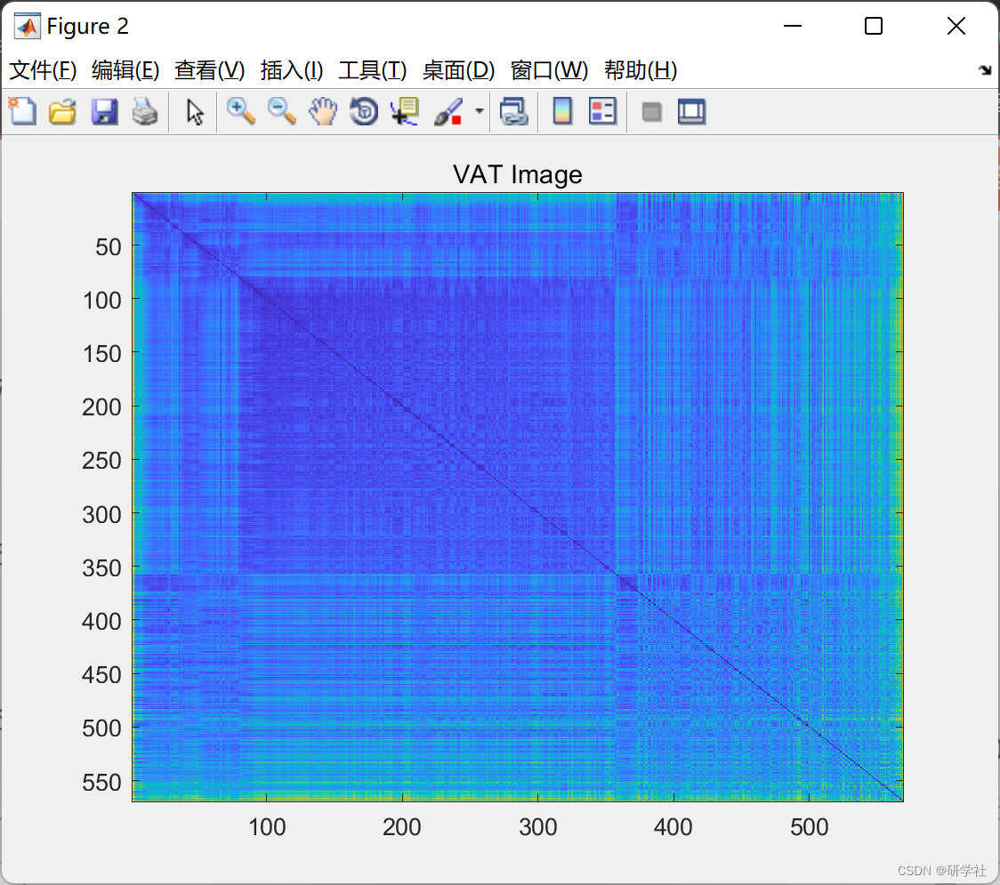

# Analysis of Wisconsin Breast Cancer (diagnosis) Data Based on GFS using Matlab Code

🏆 Bloggers' Advantages: 🌞🌞🌞 The content of the blog is assiduously thought-out and logically clear to facilitate readers.
⛳️ Mantra: A journey of a thousand miles begins with a single step. 📜 1 Overview📚 2 Run Results🎉 3 References🌈 4 MATLAB Code Implementation 💥
💥 1 Overview Developing a precise system to analyze breast cancer image data can give doctors additional confidence in evaluating patients, and can be used to scan all past scans in a clinic database to understand if any patients are at risk. Fuzzy logic systems are well suited for building knowledge bases and rule bases that can accurately approximate human expert knowledge, such as regular diagnosticians of breast cancer. Genetic algorithms improve the capability of fuzzy logic systems by learning the best membership functions and rule bases using subsets of data, especially when given a representative dataset of the system. The combination of these two technologies can be used to develop highly accurate cancer diagnosis approximations.  
📚 2 Run Results​ Edit  
​ Edit ​ Edit  
​ Edit ​ Edit  
Part of the code:  
clear all  
clc  
load wbcds.mat  
load train-valds.mat  
% Setting up the Genetic Algorithm:  
Prob.goal = @funcfit; % Goal of the algorithm  
Prob.vari = 30;    % Number of genes  
P = 25;        % Number of chromosomes  
G = Prob.vari;    % Number of genes  
MG = 100;       % Max number of generations
Pc = .9;       % Probablity of crossover  
Pm = 0.3;       % Probablity of mutation  
Er = 0.04;      % Probabilty of elitism  
visualize = 1;    % Plot the best solution over time  
[MostFit] = GA(P,G,MG,Pc,Pm,Er,Prob.goal,visualize,trainds)  
% Display the results:  
disp('The best chromosome found: ')  
MostFit.Gene  
disp('The best fitness value: ')  
MostFit.Fit  
disp('Shortest Distance')  
MostFit.Gene  
clc  
clf  
clear all  
load wbcdnoid.mat  
load dsinfo.mat  
K=5; % Number of clusters  
% Normalize data  
normwbcd = normalize(wbcd);  
% Use fcm function to find K clusters in this data set:  
[center,U,objFcn] = fcm(normwbcd,K)  
% Plot convergence:  
figure(1)  
plot(objFcn)  
% Find which data belong to which cluster:  
maxU = max(U);  
index1 = find(U(1, :) == maxU);  
index2 = find(U(2, :) == maxU);  
index3 = find(U(3, :) == maxU);  
index4 = find(U(4, :) == maxU);  
index5 = find(U(5, :) == maxU);  
% Sort clusters into their own matrices:  
id1 = zeros(length(index1),31);  
for k = 1:length(index1)  
id1(k,:) = wbcd(index1(k),:);  
end  
id2 = zeros(length(index2),31);  
for k = 1:length(index2)  
id2(k,:) = wbcd(index2(k),:);  
end  
id3 = zeros(length(index3),31);  
for k = 1:length(index3)  
id3(k,:) = wbcd(index3(k),:);  
end  
id4 = zeros(length(index4),31);  
for k = 1:length(index4)  
id4(k,:) = wbcd(index4(k),:);  
end  
id5 = zeros(length(index5),31);  
for k = 1:length(index5)  
id5(k,:) = wbcd(index5(k),:);  
end  
% Find min / max / range / median for clusters:  
id1info = [min(id1); max(id1); max(id1)-min(id1); median(id1)];  
id1mp = (median(id1) - wbcdmin)./wbcrange;  
id2info = [min(id2); max(id2); max(id2)-min(id2); median(id2)];  
id2mp = (median(id2) - wbcdmin)./wbcrange;  
id3info = [min(id3); max(id3); max(id3)-min(id3); median(id3)];  
id3mp = (median(id3) - wbcdmin)./wbcrange;  
id4info = [min(id4); max(id4); max(id4)-min(id4); median(id4)];  
id4mp = (median(id4) - wbcdmin)./wbcrange;  
id5info = [min(id5); max(id5); max(id5)-min(id5); median(id5)];  
id5mp = (median(id5) - wbcdmin)./wbcrange;  
🎉3 References  
🌈4 Matlab Code Implementation

## Images

<!-- PAYMENT_BLOCK -->

## Get this dataset

- Payment link (Stripe): [Buy now](https://buy.stripe.com/3cs8yP7sY87d0vu9AB)
- Payment QR code: 

<!-- /PAYMENT_BLOCK -->
